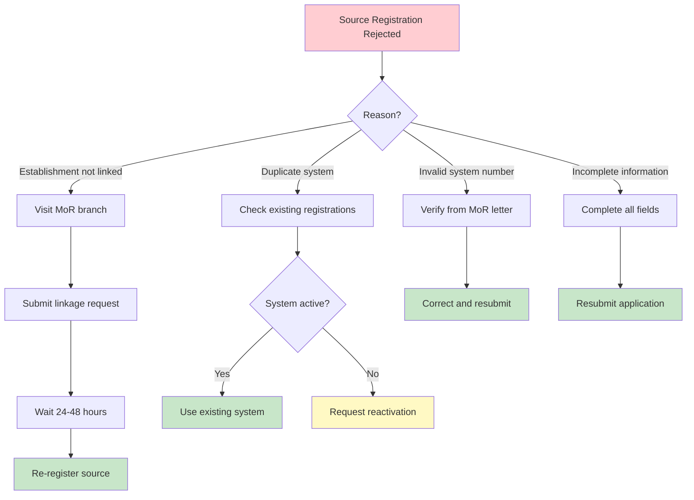
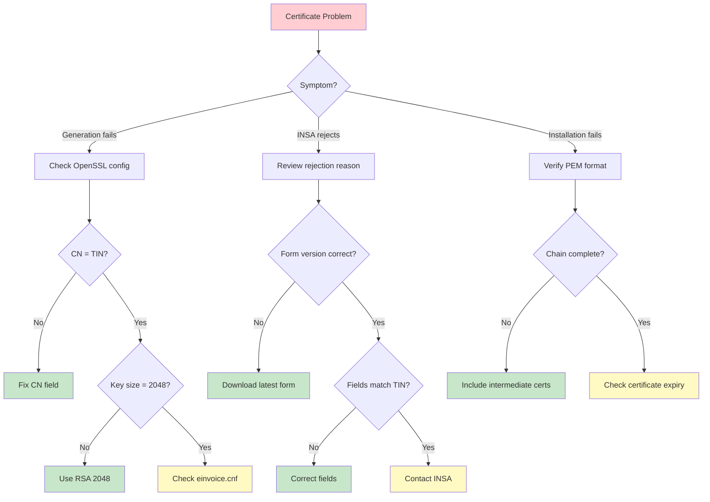
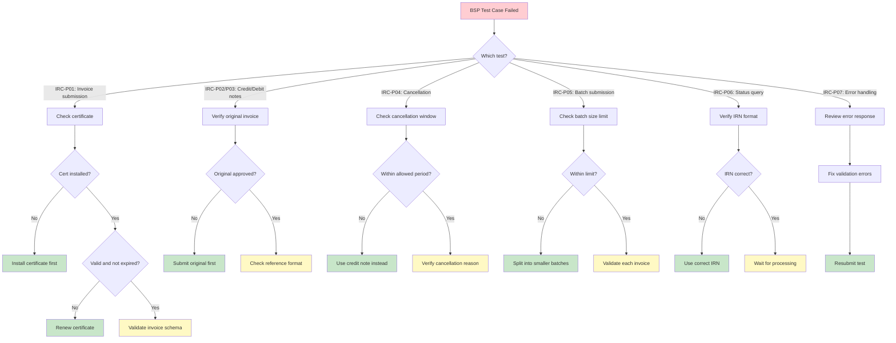
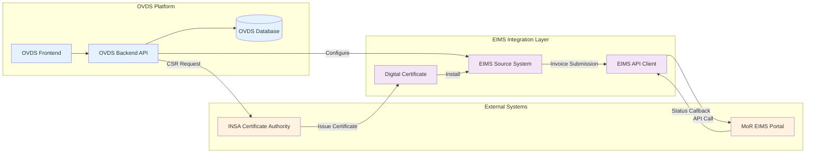

# MoR EIMS Self-Onboarding & Source Registration Guide

> **Audience:** Ethiopian taxpayers registering for the Ministry of Revenue (MoR) Electronic Invoicing Management System (EIMS)  
> **Prerequisite:** Valid Taxpayer Identification Number (TIN)  
> **Related:** [MoR Onboarding Checklist API](../../packages/shared/src/eims/mor-onboarding-checklist.ts) · [Company & Tax Settings](../03-settings/company-and-tax.md) · [System Administration Setup](../03-settings/system-administration-setup.md)

---

## Contents

- [Overview](#overview)
- [Prerequisites](#prerequisites)
- [Workflow Overview](#workflow-overview)
- [Phase 1: Self-Onboarding](#phase-1-self-onboarding-taxpayer-portal)
- [Phase 2: Source Registration](#phase-2-source-registration)
- [Phase 3: INSA Certificate](#phase-3-insa-certificate)
- [Phase 4: BSP Submission](#phase-4-bsp-submission)
- [Quick Reference](#quick-reference)
- [Status Tracking](#status-tracking)
- [Decision Trees](#decision-trees)
- [Cost Breakdown](#cost-breakdown)
- [Next Steps](#next-steps)
- [Post-Activation Operations](#post-activation-operations)
- [OVDS Configuration Walkthrough](#ovds-configuration-walkthrough)
- [Webhook Configuration](#webhook-configuration)
- [Sandbox Testing Guide](#sandbox-testing-guide)
- [Multi-Establishment Management](#multi-establishment-management)
- [Integration Architecture](#integration-architecture)
- [Troubleshooting](#troubleshooting)
- [Error Code Reference](#error-code-reference)
- [Common Rejection Reasons](#common-rejection-reasons)
- [Certificate Renewal](#certificate-renewal)
- [Emergency Procedures](#emergency-procedures)
- [Regional MoR Offices](#Regional-mor-offices)
- [Compliance Maintenance](#compliance-maintenance)
- [Pre-Go-Live Checklist](#pre-go-live-checklist)
- [Glossary](#glossary)
- [Frequently Asked Questions](#frequently-asked-questions)
- [Security Best Practices](#security-best-practices)
- [Contact & Support](#contact--support)
- [Document Templates Reference](#document-templates-reference)
- [Printable Checklist](#printable-checklist)
- [Document Changelog](#document-changelog)

---

## Overview

This guide walks you through the complete process of:

1. **Self-Onboarding** — Creating your MoR EIMS portal account
2. **Source Registration** — Registering your invoicing source system with MoR
3. **INSA Certificate** — Generating keys and obtaining your digital certificate from INSA
4. **BSP Submission** — Completing MoR Business Service Provider requirements

> **Legend:**  
> 🔵 **OVDS-supported** — Automated or assisted by OVDS  
> ⚪ **Manual step** — Performed directly on the MoR portal

---

## Prerequisites

Before starting the onboarding process, ensure you have the following:

### Required Information
- [ ] **Valid TIN** — 10-digit Taxpayer Identification Number (active and propagated in MoR systems)
- [ ] **Establishment details** — Registration number and legal name as registered with MoR
- [ ] **Contact information** — Email address and mobile number linked to your TIN
- [ ] **Legal entity documents** — Business registration certificate and trade license

### Required Access
- [ ] **MoR portal access** — Ability to visit https://core.mor.gov.et
- [ ] **Email access** — Active email account for verification and credential delivery
- [ ] **Mobile phone** — For SMS verification (if selected as notification method)

### Required Tools
- [ ] **Modern web browser** — Chrome, Firefox, or Edge with JavaScript enabled
- [ ] **OpenSSL** — For CSR generation (Phase 3) — [Download OpenSSL](https://slproweb.com/products/Win32OpenSSL.html)
- [ ] **PDF reader** — For viewing guidelines and completing forms
- [ ] **Printer** — For printing and signing BSP documents

### Who Should Perform This Process

| Role | Responsibility |
|------|---------------|
| **Company Admin** | Initiate registration, manage portal credentials |
| **Accountant/ Finance Manager** | Complete source registration, submit BSP documents |
| **IT Administrator** | Generate CSR, manage certificates, configure OVDS integration |
| **Authorized Signatory** | Sign Letter of Guarantee and Commitment Form |

> **Tip:** Assign one person as the **EIMS Coordinator** to oversee the entire process and track progress.

---

## Workflow Overview

```mermaid
flowchart TD
    A[Start] --> B{Phase 1: Self-Onboarding}
    B --> B1[Step 1: Go to portal signup]
    B1 --> B2[Step 2: Enter TIN & accept terms]
    B2 --> B3[Step 3: Receive verification code]
    B3 --> B4[Step 4: Verify account]
    B4 --> B5[Step 5: Receive credentials]
    B5 --> B6[Step 6: Log in to portal]
    B6 --> B7[Step 7: Enable 2FA]
    
    B7 --> C{Phase 2: Source Registration}
    C --> C1[Step 8: Source Management → Enterprise]
    C1 --> C2[Step 9: Select establishment]
    C2 --> C3[Step 10: Add source system]
    C3 --> C4[Step 11: MoR officer approval]
    
    C4 --> D{Phase 3: INSA Certificate}
    D --> D1[Step 12: Generate RSA 2048 Key Pair & CSR]
    D1 --> D2[Step 13: Submit request to INSA]
    D2 --> D3[Step 14: Install digital certificate]
    
    D3 --> E{Phase 4: BSP Submission}
    E --> E1[Step 15: Submit Letter of Guarantee]
    E1 --> E2[Step 16: Submit Commitment Form]
    E2 --> E3[Step 17: Execute BSP test cases]
    
    E3 --> F[EIMS Integration Active ✓]
    
    style A fill:#e1f5fe
    style F fill:#c8e6c9
    style B fill:#fff3e0
    style C fill:#fff3e0
    style D fill:#fff3e0
    style E fill:#fff3e0
```



### Estimated Timeframes

| Phase | Typical Duration | Dependencies |
|-------|-----------------|--------------|
| **Phase 1: Self-Onboarding** | 15–30 minutes | Active TIN |
| **Phase 2: Source Registration** | 1–3 business days | Phase 1 complete |
| **Phase 3: INSA Certificate** | 5–10 business days | Phase 2 approved |
| **Phase 4: BSP Submission** | 3–5 business days | Phase 3 complete |
| **Total** | **~2–4 weeks** | — |

---

## Phase 1: Self-Onboarding (Taxpayer Portal)

### Step 1 — Navigate to the MoR Portal Signup Page

⚪ Go to the MoR EIMS taxpayer portal:  
**URL:** [https://core.mor.gov.et](https://core.mor.gov.et)

> **Tip:** Use a modern browser (Chrome, Firefox, or Edge) with JavaScript enabled.

---

### Step 2 — Complete the Registration Form

⚪ On the signup page, provide the following:

| Field | Description |
|-------|-------------|
| **TIN** | Your 10-digit Taxpayer Identification Number |
| **Notification Option** | Choose how to receive verification codes (Email or SMS) |
| **Terms & Conditions** | Check the box to accept MoR's terms |

Click **Register** to submit.

> **Note:** The TIN must be active and registered with MoR. If your TIN is new, allow 24–48 hours for system propagation.

---

### Step 3 — Receive Your Verification Code

⚪ After submitting, a verification code is sent via your selected notification method.

| Method | Where to Look |
|--------|--------------|
| **Email** | Inbox — if not received within 5 minutes, check your **Spam/Junk** folder |
| **SMS** | Phone inbox — ensure your mobile number is registered with MoR |

> **Troubleshooting:**  
> - No email after 10 minutes? Check spam, then click **Resend Code** on the portal.  
> - No SMS? Verify your mobile number is linked to your TIN at your local MoR branch.

---

### Step 4 — Verify Your Account

⚪ Enter the verification code on the portal and click **Verify**.

> **Important:** Verification codes expire after **15 minutes**. Request a new code if expired.

---

### Step 5 — Receive Login Credentials

⚪ Upon successful verification, MoR registers your TIN and sends login credentials to your registered email/phone.

🔵 **OVDS support:** Store these credentials securely in your OVDS source system configuration for integrated access.

---

### Step 6 — Log In to the MoR Portal

⚪ Navigate to the MoR portal login page and enter the credentials you received.

**URL:** [https://core.mor.gov.et](https://core.mor.gov.et)

---

### Step 7 — Enable Two-Factor Authentication (2FA)

⚪ After first login, enable **Two-Factor Authentication** on the MoR portal.

🔵 **OVDS note:** OVDS enforces MFA for admin users (OTP-based 2FA). Align your MoR 2FA method with your OVDS security settings for consistent access.

> **Security best practice:** Use an authenticator app (Google Authenticator, Authy) rather than SMS where possible.

---

## Phase 2: Source Registration

### Step 8 — Access Source Management

⚪ In the MoR portal, navigate to:  
**Source Management → Enterprise**

---

### Step 9 — Select Your Establishment

⚪ From the establishments list, choose the establishment you want to register.

> **Note:** If your establishment does not appear, ensure it is linked to your TIN in MoR's records.

---

### Step 10 — Add a Source System

⚪ Click **Add Source**, then:

1. Select your **Source System Number** from the dropdown
2. Click **Search**

🔵 **OVDS support:** Source system records are tracked via `POST /api/eims/source-systems`. The system number is assigned by MoR.

---

### Step 11 — MoR Officer Approval

⚪ After submission, your source system status shows as **Pending**.

The request is routed to the MoR back office for review and approval by an authorized MoR officer.

🔵 **OVDS support:** Approval status is tracked via `PUT /api/eims/source-systems/:id/approve`. Once approved, status changes to **APPROVED**.

> **Typical approval time:** 1–3 business days. Contact your local MoR branch if pending beyond 5 days.

---

## Phase 3: INSA Certificate

> **Prerequisite:** Source Registration approved (status: APPROVED)  
> **Authority:** Information Network Security Administration (INSA)  
> **Reference:** INSA `certificate_guideline.pdf`

### Step 12 — Generate RSA 2048 Key Pair & CSR

🔵 **OVDS support:** `POST /api/eims/certificates/generate-csr`

Generate a Certificate Signing Request (CSR) with the following parameters:

| Field | Value |
|-------|-------|
| **Key Algorithm** | RSA |
| **Key Size** | 2048 bits |
| **Signature Algorithm** | SHA512withRSA |
| **CN (Common Name)** | Your 10-digit TIN |
| **serialNumber** | MoR System Number (assigned during source registration) |
| **C** | ET (Ethiopia) |
| **O** | Legal entity name (as registered) |
| **emailAddress** | Contact email for INSA correspondence |

**OpenSSL command reference:**
```bash
openssl req -new -key private_key.key -out csr.pem -config einvoice.cnf
```

> **Note:** Store your private key securely. It is required for certificate installation and must never be shared.

---

### Step 13 — Submit Certificate Request Form to INSA

⚪ Email the following to **INSA Certificate Authority:**

- **To:** [ica@insa.gov.et](mailto:ica@insa.gov.et)
- **Attachments:**
  - Generated CSR file (`csr.pem`)
  - Completed **Certificate Request Form v.1** (`.docx`)

🔵 **OVDS support:** `POST /api/eims/certificates/:id/submit-csr` — tracks submission status

> **Tip:** Use the subject line format: `EIMS Certificate Request — TIN [your TIN]`

---

### Step 14 — Install INSA-Issued Digital Certificate

⚪ After INSA approval, you receive your digital certificate (PEM format). Upload it to the MoR portal.

🔵 **OVDS support:** `POST /api/eims/certificates/:id/install` — verifies expiry date and stores certificate

> **Important:** Note the certificate expiry date. Set a reminder to renew **30 days before expiration** to avoid service interruption.

---

## Phase 4: BSP Submission

> **Prerequisite:** INSA Certificate installed  
> **Authority:** MoR Business Service Provider (BSP) unit  
> **Reference:** `MoR_BSP_Master.docx`

### Step 15 — Submit Letter of Guarantee

⚪ Submit a signed **Letter of Guarantee** per MoR BSP requirements.

🔵 **OVDS support:** Document tracking in onboarding checklist (manual upload)

> **Template:** `Letter of Gurantee-after comment-V1.2.docx`

---

### Step 16 — Submit Commitment Form

⚪ Submit a signed **Commitment Form v1.1** for EIRMS integration.

🔵 **OVDS support:** Document tracking in onboarding checklist (manual upload)

> **Template:** `Commitment Form ?1.1.docx`

---

### Step 17 — Execute MoR BSP Test Cases

⚪ Complete the MoR BSP test cases in the sandbox environment:

| Test Case | Description |
|-----------|-------------|
| **IRC-P01** | Invoice submission |
| **IRC-P02** | Credit note processing |
| **IRC-P03** | Debit note processing |
| **IRC-P04** | Invoice cancellation |
| **IRC-P05** | Batch invoice submission |
| **IRC-P06** | Invoice status query |
| **IRC-P07** | Error handling & validation |

🔵 **OVDS support:** `GET /api/eims/compliance/bsp-checklist` — tracks test case completion

> **Requirement:** Attach printouts with Invoice Reference Numbers (IRNs) as proof of successful execution.

---

## Quick Reference

| Step | Action | OVDS Support | Endpoint |
|------|--------|:------------:|----------|
| 1 | Go to portal signup | ⚪ | — |
| 2 | Enter TIN, accept terms | ⚪ | — |
| 3 | Receive verification code | ⚪ | — |
| 4 | Enter code and verify | ⚪ | — |
| 5 | Receive credentials | 🔵 | Stored in source config |
| 6 | Log in to portal | ⚪ | — |
| 7 | Enable 2FA | 🔵 | OVDS MFA enforced |
| 8 | Source Management → Enterprise | 🔵 | Tracked in record |
| 9 | Select establishment | 🔵 | Tracked in record |
| 10 | Add source system | 🔵 | `POST /api/eims/source-systems` |
| 11 | MoR officer approval | 🔵 | `PUT /api/eims/source-systems/:id/approve` |
| 12 | Generate RSA 2048 Key Pair & CSR | 🔵 | `POST /api/eims/certificates/generate-csr` |
| 13 | Submit Certificate Request to INSA | 🔵 | `POST /api/eims/certificates/:id/submit-csr` |
| 14 | Install INSA digital certificate | 🔵 | `POST /api/eims/certificates/:id/install` |
| 15 | Submit Letter of Guarantee | 🔵 | Document tracking |
| 16 | Submit Commitment Form | 🔵 | Document tracking |
| 17 | Execute MoR BSP Test Cases | 🔵 | `GET /api/eims/compliance/bsp-checklist` |

---

## Status Tracking

### OVDS Dashboard Indicators

Track your onboarding progress directly in the OVDS interface:

| Status | Indicator | Meaning |
|--------|-----------|---------|
| **Not Started** | ⚪ Gray | Phase not yet initiated |
| **In Progress** | 🟡 Yellow | Phase started, awaiting completion |
| **Pending Approval** | 🔵 Blue | Submitted to MoR/INSA, awaiting review |
| **Approved** | 🟢 Green | Phase completed successfully |
| **Rejected** | 🔴 Red | Phase rejected — see rejection reason |

### Checking Status in OVDS

1. Navigate to **Settings → EIMS Settings** (`/settings/eims`)
2. View the **Onboarding Progress** panel
3. Each phase displays current status and completion percentage
4. Click any phase for detailed step-by-step progress

### API Status Values

For programmatic tracking via OVDS API:

```typescript
type OnboardingStatus = 
  | 'NOT_STARTED'
  | 'IN_PROGRESS' 
  | 'PENDING_APPROVAL'
  | 'APPROVED'
  | 'REJECTED';

type SourceRegistrationStep =
  | 'ENTERPRISE_SELECTED'
  | 'ESTABLISHMENT_SELECTED'
  | 'SOURCE_ADDED'
  | 'PENDING_APPROVAL'
  | 'APPROVED';
```

---

## Decision Trees

### Source Registration Rejection



### Certificate Issues



### BSP Test Case Failure



---

## Cost Breakdown

### Fee Structure

| Phase | Fee Type | Amount | Payable To |
|-------|----------|--------|------------|
| **Phase 1: Self-Onboarding** | Registration | Free | — |
| **Phase 2: Source Registration** | Processing | Free | — |
| **Phase 3: INSA Certificate** | Certificate issuance | Contact INSA | INSA |
| **Phase 3: INSA Certificate** | Key generation tools | Free (OpenSSL) | — |
| **Phase 4: BSP Submission** | BSP certification | Contact MoR | MoR |
| **Phase 4: BSP Submission** | Document notarization | Varies | Notary |

### Potential Additional Costs

| Item | Estimated Cost | Notes |
|------|---------------|-------|
| Digital certificate (INSA) | Per INSA fee schedule | Valid 1-3 years |
| Document notarization | ETB 200-500 | Per document |
| Legal consultation | Varies | Optional |
| OVDS subscription | Per OVDS plan | See [Monetization](../08-advanced/monetization-and-plans.md) |

> **Note:** MoR EIMS registration itself is free. Costs are primarily for INSA certificates and optional professional services.

---

## Next Steps

After completing all four phases, your EIMS integration is active. Proceed to:

1. **OVDS Configuration** — Configure your source system in OVDS for automated invoice submission
2. **First Invoice** — Submit your first electronic invoice through the MoR portal
3. **VAT Filing** — Begin monthly VAT returns with EIMS data

> See [Company & Tax Settings](../03-settings/company-and-tax.md) for OVDS-side configuration.

---

## Post-Activation Operations

Once EIMS is active, follow these operational procedures:

### Daily Operations

| Task | Frequency | OVDS Support |
|------|-----------|--------------|
| Submit sales invoices | Per transaction | 🔵 Automated via API |
| Issue credit/debit notes | As needed | 🔵 Automated via API |
| Verify invoice status | Per submission | 🔵 Real-time status |
| Download customer invoices | As needed | 🔵 Bulk export |

### Periodic Tasks

| Task | Frequency | Description |
|------|-----------|-------------|
| VAT monthly filing | Monthly | Submit VAT return with EIMS data |
| Certificate expiry check | Weekly | Monitor certificate validity |
| Reconciliation | Monthly | Match EIMS invoices with GL |
| BSP compliance audit | Annual | Verify ongoing compliance |

### Invoice Lifecycle in EIMS

```
┌─────────┐    ┌─────────┐    ┌─────────┐    ┌─────────┐
│  DRAFT  │───▶│ SUBMITTED│───▶│ APPROVED│───▶│ SETTLED │
└─────────┘    └─────────┘    └─────────┘    └─────────┘
                    │                              │
                    ▼                              ▼
              ┌─────────┐                    ┌─────────┐
              │ REJECTED│                    │CANCELLED│
              └─────────┘                    └─────────┘
```

| Status | Meaning | Action Required |
|--------|---------|-----------------|
| **Draft** | Invoice created, not submitted | Review and submit |
| **Submitted** | Sent to MoR for validation | Await approval |
| **Approved** | MoR validated, IRN assigned | Complete transaction |
| **Rejected** | Validation failed | Fix errors and resubmit |
| **Settled** | Payment completed | Archive |
| **Cancelled** | Voided by seller | Issue credit note if needed |

---

## Integration Architecture

### System Overview



### Data Flow

```
┌─────────────────────────────────────────────────────────────────┐
│                        OVDS Platform                            │
│                                                                 │
│  Invoice Creation ──▶ Tax Calculation ──▶ EIMS Formatting      │
│                                               │                 │
│                                               ▼                 │
│                                    Digital Signature (INSA)     │
│                                               │                 │
│                                               ▼                 │
│                                    MoR EIMS Submission          │
│                                               │                 │
│                                               ▼                 │
│                                    IRN + Status Response        │
└─────────────────────────────────────────────────────────────────┘
```

### API Endpoints Reference

| Operation | Method | Endpoint | Description |
|-----------|--------|----------|-------------|
| Create source system | `POST` | `/api/eims/source-systems` | Register new source |
| Get source status | `GET` | `/api/eims/source-systems/:id` | Check approval status |
| Approve source | `PUT` | `/api/eims/source-systems/:id/approve` | MoR approval |
| Generate CSR | `POST` | `/api/eims/certificates/generate-csr` | Create key pair + CSR |
| Submit CSR | `POST` | `/api/eims/certificates/:id/submit-csr` | Send to INSA |
| Install certificate | `POST` | `/api/eims/certificates/:id/install` | Upload PEM |
| Get BSP checklist | `GET` | `/api/eims/compliance/bsp-checklist` | Test case status |
| Submit invoice | `POST` | `/api/eims/invoices` | Send to MoR |
| Get invoice status | `GET` | `/api/eims/invoices/:id` | Check IRN status |

---

## Troubleshooting

| Issue | Resolution |
|-------|------------|
| TIN not recognized on portal | Verify TIN is active; wait 24–48 hours after TIN issuance |
| Verification code not received | Check spam folder; use Resend Code; verify contact details at MoR branch |
| Establishment not in list | Ensure establishment is linked to your TIN at MoR |
| Source stuck in Pending > 5 days | Contact local MoR branch with your TIN and source system number |
| Lost login credentials | Use "Forgot Password" on portal or visit MoR branch with TIN documentation |
| CSR generation fails | Verify OpenSSL config matches INSA requirements (CN=TIN, serialNumber=System Number) |
| INSA rejects certificate request | Ensure Certificate Request Form is v.1 and all fields match TIN records |
| Certificate upload fails | Verify PEM format and that the certificate chain is complete |
| BSP test case fails | Review error response; ensure certificate is installed and not expired |

---

## Common Rejection Reasons

Avoid these common mistakes that cause delays or rejections:

### Phase 1: Self-Onboarding

| Issue | Cause | Prevention |
|-------|-------|------------|
| TIN not recognized | TIN newly issued, not yet in MoR system | Wait 24–48 hours after TIN issuance |
| Verification code expired | Code older than 15 minutes | Enter code immediately; use Resend if needed |
| Invalid notification option | Email/phone not linked to TIN | Update contact details at MoR branch first |

### Phase 2: Source Registration

| Issue | Cause | Prevention |
|-------|-------|------------|
| Establishment not found | Establishment not linked to TIN | Visit MoR branch to link establishment |
| Duplicate source system | System already registered | Check existing registrations before adding |
| Invalid system number | Typo in system number | Verify number from MoR approval letter |

### Phase 3: INSA Certificate

| Issue | Cause | Prevention |
|-------|-------|------------|
| CSR validation failed | CN or serialNumber incorrect | Use TIN as CN, MoR System Number as serialNumber |
| Missing subject fields | Incomplete CSR | Include all required fields per INSA guidelines |
| Wrong key size | Key not 2048 bits | Specify `-newkey rsa:2048` in OpenSSL command |
| Form version mismatch | Using outdated request form | Download latest form from INSA |

### Phase 4: BSP Submission

| Issue | Cause | Prevention |
|-------|-------|------------|
| Unsigned documents | Missing authorized signature | Ensure signatory signs all pages |
| Expired templates | Using old template versions | Download current templates from MoR |
| Test case failure | Certificate not installed or expired | Verify certificate status before testing |
| Missing IRNs | Printouts without reference numbers | Include IRN on all test case printouts |

---

## Certificate Renewal

Digital certificates expire periodically. Follow this process to renew:

### Renewal Timeline

```
┌─────────────────────────────────────────────────────────────┐
│  Certificate Issued                                         │
│  └── 6 months before expiry: Plan renewal                  │
│      └── 30 days before expiry: Submit renewal request     │
│          └── 14 days before expiry: Install new certificate│
│              └── Expiry date: Service interruption risk     │
└─────────────────────────────────────────────────────────────┘
```

### Renewal Steps

1. **Generate new CSR** — Use same process as Step 12 (new key pair recommended)
2. **Submit renewal request** — Email to INSA with new CSR and renewal form
3. **Receive new certificate** — INSA issues renewed certificate
4. **Install new certificate** — Upload to MoR portal (Step 14)
5. **Update OVDS** — System automatically detects new certificate
6. **Verify integration** — Submit test invoice to confirm functionality

> **Important:** Keep the old certificate installed until the new one is confirmed working to avoid service interruption.

---

## Error Code Reference

### MoR EIMS API Error Codes

| Code | Message | Cause | Resolution |
|------|---------|-------|------------|
| `EIMS-001` | Invalid TIN | TIN format incorrect or not found | Verify 10-digit TIN |
| `EIMS-002` | Source system not found | System number not registered | Complete Phase 2 first |
| `EIMS-003` | Certificate expired | Digital certificate past validity | Renew certificate |
| `EIMS-004` | Invalid signature | Certificate mismatch or corrupted | Reinstall certificate |
| `EIMS-005` | Duplicate invoice | Same invoice submitted twice | Check before resubmitting |
| `EIMS-006` | Schema validation failed | Invoice format incorrect | Validate against MoR schema |
| `EIMS-007` | Rate limit exceeded | Too many API calls | Implement exponential backoff |
| `EIMS-008` | MoR system unavailable | MoR portal maintenance | Retry after 15 minutes |
| `EIMS-009` | BSP not approved | Test cases incomplete | Complete Phase 4 |
| `EIMS-010` | Unauthorized access | Invalid or expired credentials | Refresh authentication |

### INSA Certificate Error Codes

| Code | Message | Cause | Resolution |
|------|---------|-------|------------|
| `INSA-001` | Invalid CSR format | CSR not PEM encoded | Regenerate with correct format |
| `INSA-002` | CN mismatch | Common Name doesn't match TIN | Use TIN as CN |
| `INSA-003` | Weak key | Key size less than 2048 bits | Use RSA 2048 |
| `INSA-004` | Missing fields | Required subject fields incomplete | Include all mandatory fields |
| `INSA-005` | Request form invalid | Wrong form version or incomplete | Download latest form |

### HTTP Status Codes

| Status | Meaning | Action |
|--------|---------|--------|
| `200` | Success | Operation completed |
| `400` | Bad Request | Check request payload |
| `401` | Unauthorized | Re-authenticate |
| `403` | Forbidden | Verify permissions |
| `404` | Not Found | Check resource ID |
| `409` | Conflict | Resource already exists |
| `429` | Too Many Requests | Implement rate limiting |
| `500` | Server Error | Retry or contact support |

---

## Emergency Procedures

### Certificate Compromise

If you suspect your private key has been compromised:

```
IMMEDIATE ACTIONS (within 1 hour)
═════════════════════════════════
1. REVOKE certificate via INSA
   → Email: ica@insa.gov.et
   → Subject: URGENT: Certificate Revocation — TIN [your TIN]

2. DISABLE EIMS integration in OVDS
   → Settings → EIMS → Disable Source

3. NOTIFY MoR
   → Contact local MoR branch
   → Report potential unauthorized access

4. GENERATE new key pair
   → Create new CSR with new private key
   → Submit renewal request to INSA

5. INVESTIGATE scope
   → Review access logs
   → Identify affected transactions
```

### MoR System Outage

If MoR EIMS portal is unavailable:

| Duration | Action |
|----------|--------|
| **< 1 hour** | Wait and retry; OVDS auto-queues submissions |
| **1-4 hours** | Enable offline mode; record invoices locally |
| **> 4 hours** | Contact MoR; activate business continuity plan |

**Business Continuity Steps:**
1. Record all transactions in OVDS (offline mode)
2. Issue manual receipts to customers
3. Submit batched invoices when service resumes
4. Document outage period for audit trail

### Data Breach Response

```
BREACH RESPONSE FLOWCHART
════════════════════════

Breach Detected
      │
      ▼
┌─────────────────┐
│ Assess severity │
└────────┬────────┘
         │
    ┌────┴────┐
    ▼         ▼
 Minor     Major
    │         │
    ▼         ▼
 Log &    Notify within
 fix      24 hours:
          • MoR
          • INSA
          • Affected customers
          • Data protection authority
```

### Contact for Emergencies

| Situation | Contact | Priority |
|-----------|---------|----------|
| Certificate compromise | INSA: ica@insa.gov.et | Critical |
| MoR system outage | Local MoR branch | High |
| Unauthorized transactions | MoR + OVDS support | Critical |
| Data breach | Legal + MoR + INSA | Critical |
| OVDS integration failure | OVDS support | Medium |

---

## Regional MoR Offices

Visit your local MoR branch for in-person assistance:

| Region | Location | Services |
|--------|----------|----------|
| **Addis Ababa** | Head Office, Mexico Square | All EIMS services |
| **Oromia** | Adama Branch | Source registration, approvals |
| **Amhara** | Bahir Dar Branch | TIN updates, establishment linkage |
| **Tigray** | Mekelle Branch | General inquiries |
| **SNNPR** | Hawassa Branch | Document submission |
| **Sidama** | Hawassa Branch | Document submission |
| **Dire Dawa** | Dire Dawa Branch | All EIMS services |
| **Harari** | Harar Branch | General inquiries |

> **Tip:** Bring your TIN certificate and business registration documents when visiting any MoR office.

---

## Compliance Maintenance

After EIMS activation, maintain compliance with these requirements:

### Ongoing Obligations

| Requirement | Frequency | Consequence of Non-Compliance |
|-------------|-----------|-------------------------------|
| Submit all sales invoices | Per transaction | Penalties per unfiled invoice |
| File VAT returns | Monthly | Late filing penalties |
| Maintain certificate validity | Continuous | Service interruption |
| Retain invoice records | 5+ years | Audit issues |
| Report system changes | As they occur | Compliance violations |

### Certificate Monitoring

```
┌────────────────────────────────────────────────────────────┐
│                  Certificate Health Check                   │
├────────────────────────────────────────────────────────────┤
│  □ Certificate installed and valid                        │
│  □ Expiry date > 30 days away                             │
│  □ Private key secure and accessible                      │
│  □ Backup certificate stored securely                     │
│  □ Renewal process initiated (if < 60 days)              │
└────────────────────────────────────────────────────────────┘
```

### Annual BSP Requirements

- Verify BSP compliance status annually
- Retest if system changes occur
- Update commitment forms if business details change
- Maintain audit trail of all EIMS transactions

---

## OVDS Configuration Walkthrough

After EIMS activation, configure OVDS for integrated operations:

### Step 1: Access EIMS Settings

1. Log in to OVDS as **Company Admin**
2. Navigate to **Settings → EIMS Settings** (`/settings/eims`)
3. Click **Configure New Source**

### Step 2: Enter Source System Details

| Field | Value | Source |
|-------|-------|--------|
| **Source System Number** | Your MoR-assigned number | MoR approval letter |
| **TIN** | 10-digit taxpayer ID | TIN certificate |
| **Establishment Code** | Your establishment identifier | MoR portal |
| **Certificate** | Upload PEM file | INSA |

### Step 3: Configure API Access

```json
{
  "sourceSystem": "EIMS-001",
  "tin": "0000000000",
  "establishmentCode": "EST-001",
  "certificatePath": "/secure/certs/eims.pem",
  "privateKeyPath": "/secure/keys/eims.key",
  "apiEndpoint": "https://core.mor.gov.et/api/eims",
  "environment": "production"
}
```

### Step 4: Test Connection

1. Click **Test Connection** in EIMS Settings
2. Verify status shows **Connected**
3. Submit a test invoice (will be sandboxed)

### Step 5: Enable Automation

| Setting | Recommended Value | Description |
|---------|------------------|-------------|
| Auto-submit invoices | Enabled | Submit invoices automatically |
| Auto-retry failures | Enabled | Retry failed submissions |
| Retry attempts | 3 | Maximum retry count |
| Retry interval | 5 minutes | Time between retries |
| Notify on failure | Enabled | Alert on submission failure |

### Step 6: Map GL Accounts

Map EIMS invoice types to OVDS GL accounts:

| Invoice Type | Debit Account | Credit Account | Tax Account |
|--------------|--------------|----------------|-------------|
| Sales (standard) | Accounts Receivable | Sales Revenue | VAT Payable (15%) |
| Sales (zero-rated) | Accounts Receivable | Sales Revenue | — |
| Export | Accounts Receivable | Export Revenue | — |
| Credit note | Sales Returns | Accounts Receivable | VAT Payable (reversal) |

---

## Webhook Configuration

Configure webhooks for real-time EIMS status updates:

### Supported Webhook Events

| Event | Description | Payload |
|-------|-------------|---------|
| `invoice.submitted` | Invoice accepted by MoR | `{ irn, status, timestamp }` |
| `invoice.approved` | Invoice validated | `{ irn, approvedAt, validUntil }` |
| `invoice.rejected` | Invoice validation failed | `{ irn, reason, errors[] }` |
| `invoice.cancelled` | Invoice voided | `{ irn, cancelledAt, reason }` |
| `certificate.expiring` | Certificate nearing expiry | `{ expiryDate, daysRemaining }` |
| `source.status_changed` | Source system status update | `{ sourceId, oldStatus, newStatus }` |

### Webhook Setup in OVDS

1. Navigate to **Settings → Notifications → Webhooks**
2. Click **Add Webhook**
3. Configure endpoint:

```json
{
  "url": "https://your-server.com/webhooks/eims",
  "events": [
    "invoice.submitted",
    "invoice.approved",
    "invoice.rejected",
    "certificate.expiring"
  ],
  "secret": "your-webhook-signing-secret",
  "active": true
}
```

### Webhook Payload Example

```json
{
  "event": "invoice.approved",
  "timestamp": "2026-08-25T14:00:00Z",
  "data": {
    "irn": "ETH-2026-0825-001234",
    "sourceSystem": "EIMS-001",
    "tin": "0000000000",
    "customerTin": "1111111111",
    "totalAmount": "11500.00",
    "vatAmount": "1500.00",
    "approvedAt": "2026-08-25T14:00:00Z",
    "validUntil": "2027-08-25T14:00:00Z"
  },
  "signature": "sha256=abc123..."
}
```

### Webhook Security

```javascript
// Verify webhook signature
const crypto = require('crypto');

function verifyWebhook(payload, signature, secret) {
  const expected = crypto
    .createHmac('sha256', secret)
    .update(JSON.stringify(payload))
    .digest('hex');
  return crypto.timingSafeEqual(
    Buffer.from(signature),
    Buffer.from(`sha256=${expected}`)
  );
}
```

### Retry Policy

| Attempt | Timing |
|---------|--------|
| 1 | Immediate |
| 2 | 30 seconds |
| 3 | 2 minutes |
| 4 | 10 minutes |
| 5 | 1 hour |

> **Note:** Webhooks are retried up to 5 times. If all fail, the event is logged and available via API.

---

## Sandbox Testing Guide

Use the MoR sandbox environment to test before going live:

### Accessing Sandbox

| Environment | URL | Purpose |
|-------------|-----|---------|
| **Sandbox** | `https://sandbox.mor.gov.et/eims` | Testing |
| **Production** | `https://core.mor.gov.et/eims` | Live operations |

### Sandbox Test Data

Use these test values in sandbox:

| Field | Test Value |
|-------|-----------|
| TIN (seller) | `0000000000` |
| TIN (buyer) | `1111111111` |
| Amount | `1000.00` |
| VAT | `150.00` |
| Item code | `TEST-001` |

### Test Scenarios

#### 1. Standard Invoice Submission

```json
POST /api/eims/invoices
{
  "sellerTin": "0000000000",
  "buyerTin": "1111111111",
  "items": [{
    "code": "TEST-001",
    "name": "Test Item",
    "quantity": 1,
    "unitPrice": 1000.00,
    "vatRate": 15
  }],
  "totalAmount": 1150.00,
  "vatAmount": 150.00
}
```

**Expected response:**
```json
{
  "irn": "SANDBOX-2026-001",
  "status": "APPROVED",
  "message": "Invoice accepted"
}
```

#### 2. Credit Note Submission

```json
POST /api/eims/credit-notes
{
  "originalIrn": "SANDBOX-2026-001",
  "reason": "Price adjustment",
  "items": [{
    "code": "TEST-001",
    "quantity": 1,
    "unitPrice": -100.00,
    "vatRate": 15
  }],
  "totalAmount": -115.00,
  "vatAmount": -15.00
}
```

#### 3. Invoice Cancellation

```json
PUT /api/eims/invoices/SANDBOX-2026-001/cancel
{
  "reason": "Customer request"
}
```

### Sandbox Limitations

| Limitation | Details |
|------------|---------|
| Rate limit | 100 requests/minute |
| Data retention | 30 days |
| Certificate | Use test certificate only |
| No real money | All transactions are simulated |

---

## Multi-Establishment Management

For businesses with multiple locations:

### Registration Strategy

```
┌─────────────────────────────────────────────────────────────┐
│                    Company (TIN)                             │
│                                                             │
│  ┌──────────────┐  ┌──────────────┐  ┌──────────────┐      │
│  │ Addis Ababa  │  │   Branch 2   │  │   Branch 3   │      │
│  │ Main Office  │  │   Adama      │  │   Bahir Dar  │      │
│  │              │  │              │  │              │      │
│  │ Source: 001  │  │ Source: 002  │  │ Source: 003  │      │
│  │ Cert: 001    │  │ Cert: 002    │  │ Cert: 003    │      │
│  └──────────────┘  └──────────────┘  └──────────────┘      │
└─────────────────────────────────────────────────────────────┘
```

### Per-Establishment Requirements

| Requirement | Per Establishment | Shared |
|-------------|------------------|--------|
| Source registration | ✅ Required | — |
| INSA certificate | ✅ Required | — |
| BSP test cases | ✅ Required | — |
| MoR portal account | — | ✅ Shared |
| OVDS configuration | ✅ Per source | — |

### OVDS Multi-Source Configuration

```json
{
  "sources": [
    {
      "id": "EIMS-001",
      "name": "Addis Ababa Main",
      "establishmentCode": "EST-001",
      "certificatePath": "/certs/main.pem",
      "default": true
    },
    {
      "id": "EIMS-002",
      "name": "Adama Branch",
      "establishmentCode": "EST-002",
      "certificatePath": "/certs/adama.pem",
      "default": false
    }
  ]
}
```

### Invoice Routing Rules

| Scenario | Routing Logic |
|----------|--------------|
| Single establishment | Route to that establishment's source |
| Multiple establishments | Route based on: 1) Customer location, 2) Item origin, 3) Default source |
| Inter-branch transactions | Use transfer pricing rules |

---

## Pre-Go-Live Checklist

Complete this checklist before submitting live invoices:

### System Verification

- [ ] EIMS source system status: **APPROVED**
- [ ] INSA certificate installed and valid (> 30 days to expiry)
- [ ] BSP test cases: **ALL PASSED** (IRC-P01 through IRC-P07)
- [ ] OVDS-EIMS connection: **TESTED**
- [ ] Test invoice submitted successfully in sandbox

### Configuration Verification

- [ ] Source system number matches MoR records
- [ ] TIN matches certificate CN field
- [ ] GL accounts mapped correctly
- [ ] Tax rates configured (VAT 15%, etc.)
- [ ] Invoice numbering sequence set

### Operational Readiness

- [ ] Staff trained on EIMS invoice creation
- [ ] Reconciliation process defined
- [ ] Error response procedure documented
- [ ] Backup certificate stored securely
- [ ] Certificate renewal calendar set

### Compliance Verification

- [ ] All BSP documents submitted and approved
- [ ] Letter of Guarantee signed and filed
- [ ] Commitment Form signed and filed
- [ ] Audit trail enabled in OVDS

---

## Glossary

| Term | Definition |
|------|-----------|
| **TIN** | Taxpayer Identification Number — 10-digit unique identifier issued by MoR |
| **EIMS** | Electronic Invoicing Management System — MoR's platform for electronic invoice processing |
| **INSA** | Information Network Security Administration — Ethiopia's national cybersecurity authority |
| **CSR** | Certificate Signing Request — encoded file containing public key and identity information |
| **PEM** | Privacy-Enhanced Mail — file format for digital certificates (Base64 encoded) |
| **BSP** | Business Service Provider — MoR's certification program for EIMS integration |
| **IRN** | Invoice Reference Number — unique identifier assigned to each submitted invoice |
| **MFA** | Multi-Factor Authentication — security requiring two or more verification methods |
| **2FA** | Two-Factor Authentication — specific MFA using exactly two verification factors |
| **RSA** | Rivest–Shamir–Adleman — asymmetric cryptographic algorithm for digital signatures |
| **OVDS** | Online VAT Declaration System — integrated platform for VAT and EIMS operations |

---

## Frequently Asked Questions

### General

**Q: How long does the entire onboarding process take?**  
A: Typically 2–4 weeks, depending on MoR and INSA processing times. Phase 1 takes 15–30 minutes, Phase 2 takes 1–3 business days, Phase 3 takes 5–10 business days, and Phase 4 takes 3–5 business days.

**Q: Can I complete multiple phases simultaneously?**  
A: No. Each phase is a prerequisite for the next. You must complete them in order.

**Q: Is there a cost for EIMS registration?**  
A: MoR EIMS registration is free. INSA may charge fees for digital certificate issuance — contact INSA for current pricing.

### Self-Onboarding

**Q: What if my TIN is newly issued?**  
A: Allow 24–48 hours for your TIN to propagate through MoR's systems before attempting registration.

**Q: Can I change my notification method after registration?**  
A: Yes. After logging in, you can update your notification preferences in the portal settings.

**Q: What if I lose my verification code?**  
A: Click **Resend Code** on the portal. Codes expire after 15 minutes for security.

### Source Registration

**Q: Can I register multiple establishments?**  
A: Yes. Repeat Phase 2 for each establishment you want to register under the same TIN.

**Q: What if my establishment doesn't appear in the list?**  
A: Ensure your establishment is linked to your TIN in MoR's records. Visit your local MoR branch to update the linkage.

### INSA Certificate

**Q: What happens if my certificate expires?**  
A: Your EIMS integration will stop working. Renew 30 days before expiration to avoid service interruption.

**Q: Can I use a certificate from a different authority?**  
A: No. MoR requires certificates issued by INSA specifically.

**Q: Do I need to generate a new CSR for renewal?**  
A: Yes. Each certificate renewal requires a fresh CSR with current information.

### BSP Submission

**Q: What are the BSP test cases?**  
A: Seven test scenarios (IRC-P01 through IRC-P07) that validate your system's ability to submit, cancel, and query invoices correctly.

**Q: Can I retest failed test cases?**  
A: Yes. Fix the issue and resubmit the test case. All seven must pass for approval.

---

## Security Best Practices

### Credential Management
- Store MoR portal credentials in a password manager — never in plain text
- Enable 2FA on both MoR portal and OVDS
- Rotate passwords every 90 days
- Never share credentials via email or messaging

### Certificate Security
- Generate private keys on a secure, air-gapped machine when possible
- Store private keys in encrypted storage (AES-256)
- Never transmit private keys via email
- Set calendar reminders 30 days before certificate expiry

### Operational Security
- Always log out of the MoR portal after use
- Verify you are on `https://core.mor.gov.et` before entering credentials
- Report suspicious emails claiming to be from MoR or INSA
- Use dedicated service accounts for automated EIMS access

---

## Contact & Support

| Organization | Purpose | Contact |
|-------------|---------|---------|
| **MoR EIMS Support** | Portal issues, source registration, approval status | Visit your local MoR branch |
| **INSA Certificate Authority** | Certificate requests, technical issues | [ica@insa.gov.et](mailto:ica@insa.gov.et) |
| **OVDS Support** | OVDS integration, API issues | See [Troubleshooting](../01-getting-started/troubleshooting.md) |

---

## Document Templates Reference

| Template | Phase | File Name | Source |
|----------|-------|-----------|--------|
| Certificate Request Form | Phase 3 | `Certificate Request Form v.1.docx` | INSA |
| Letter of Guarantee | Phase 4 | `Letter of Gurantee-after comment-V1.2.docx` | MoR |
| Commitment Form | Phase 4 | `Commitment Form ?1.1.docx` | MoR |
| BSP Master Document | Phase 4 | `MoR_BSP_Master.docx` | MoR |
| INSA Certificate Guidelines | Phase 3 | `certificate_guideline.pdf` | INSA |

> **Note:** Templates are available from MoR or INSA directly. OVDS tracks document submission status but does not provide the templates themselves.

---

## Related Documentation

- [Company & Tax Settings](../03-settings/company-and-tax.md) — Configure TIN and MoR credentials in OVDS
- [System Administration Setup](../03-settings/system-administration-setup.md) — Full setup wizard
- [MoR Onboarding Checklist (source)](../../packages/shared/src/eims/mor-onboarding-checklist.ts) — Complete 18-step checklist with API references
- [Quick Start](../01-getting-started/quick-start.md) — OVDS initial setup
- [VAT & TOT](../06-tax-compliance/vat-and-tot.md) — Monthly VAT filing with EIMS data

---

## Printable Checklist

Use this checklist to track your progress. Check off each step as completed.

```
MoR EIMS Onboarding Progress Tracker
═══════════════════════════════════════
TIN: ____________________
Company: ________________
Date Started: ____________

PHASE 1: SELF-ONBOARDING
□ Step 1  — Navigated to portal signup
□ Step 2  — Completed registration form
□ Step 3  — Received verification code
□ Step 4  — Verified account
□ Step 5  — Received login credentials
□ Step 6  — Logged in to portal
□ Step 7  — Enabled 2FA

PHASE 2: SOURCE REGISTRATION
□ Step 8  — Accessed Source Management → Enterprise
□ Step 9  — Selected establishment
□ Step 10 — Added source system
□ Step 11 — MoR officer approved (date: _______)

PHASE 3: INSA CERTIFICATE
□ Step 12 — Generated RSA 2048 Key Pair & CSR
□ Step 13 — Submitted Certificate Request to INSA
□ Step 14 — Installed INSA digital certificate

PHASE 4: BSP SUBMISSION
□ Step 15 — Submitted Letter of Guarantee
□ Step 16 — Submitted Commitment Form
□ Step 17 — Executed BSP test cases (IRC-P01–P07)

COMPLETION
□ EIMS Integration Active
□ OVDS Source System Configured
═══════════════════════════════════════
Completed by: ________________
Date: ________________
```

---

## Document Changelog

| Version | Date | Changes |
|---------|------|---------|
| **3.0** | 2026-08-25 | Complete rewrite — added all 4 phases, decision trees, cost breakdown, OVDS walkthrough, pre-go-live checklist |
| **2.0** | 2026-08-20 | Added INSA Certificate and BSP Submission phases |
| **1.0** | 2026-08-15 | Initial release — Self-Onboarding and Source Registration only |

### Contributing

Found an error or have a suggestion? Contact OVDS support or submit feedback through the documentation portal.

---

> **Disclaimer:** This guide is based on publicly available MoR and INSA documentation. Processes and requirements may change. Always verify current requirements with MoR and INSA directly.
